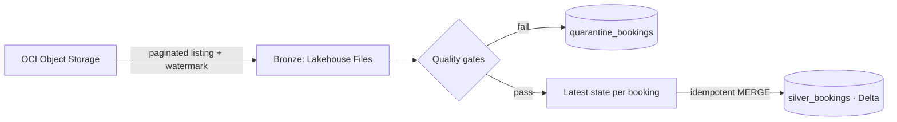

# ⚡ OCI → Microsoft Fabric Lakehouse | Incremental. Idempotent. Quality-gated.


**Fabric simulation** for a fictional hotel chain, *Costa Azul Stays*. Booking files land in **Oracle Cloud (OCI) Object Storage**, flow into a **Fabric Lakehouse** bronze layer, and become a clean **Delta** silver table. Late files are caught, bad rows get quarantined, and re-runs never duplicate data.



## Stack
`OCI Object Storage` · `Microsoft Fabric` (Lakehouse, Notebooks, OneLake) · `PySpark` · `Delta Lake` · `Parquet` · `Azure Key Vault` · `DuckDB` · `pytest` · `GitHub Actions` · `Azure DevOps`

## What it handles
- **Incremental loads:** watermark with a lookback window, so files that land late are still picked up
- **Crash-safe:** the watermark is saved only after every file lands, so a failed run simply re-runs
- **Data quality:** null IDs, bad amounts, invalid statuses and malformed timestamps go to quarantine with the failing rule, the rest keeps flowing
- **Traceability and reprocessing:** every quarantined row keeps the failing rule and a timestamp, and any batch can be replayed safely
- **Duplicates and out-of-order events:** collapse to the newest state per booking
- **Idempotent MERGE:** stale events never overwrite newer ones
- **Secrets:** OCI credentials read from Azure Key Vault at runtime, never in code

## One SQL, two engines
The silver logic (`src/ocifabric/quality.py`) is plain SQL. It runs in **Spark** inside Fabric and in **DuckDB** in the test suite, so what's tested is what ships.

## Run the tests
```bash
pip install -e ".[dev]"
pytest
```

## Run it in Fabric
1. Add the OCI secrets to a Key Vault the workspace identity can read
2. Install the package in a Fabric Environment (`pip install "ocifabric[oci] @ git+https://github.com/lucas-wall/oci-to-fabric-lakehouse"`)
3. Run `notebooks/01_bronze_oci_landing.py`, then `notebooks/02_silver_bookings.py`

> Sample data is fictional. No real customer or company data is used.
